# LAA / NR-U fairness study (Step pre_20)

## 1. The question

Step 19.F added NR-U as a secondary cell (SCell) for a licensed 5G cell
(LAA-style carrier aggregation). In that scenario, a neighboring Wi-Fi
AP dropped from **30.3 to 2.8 Mbps** when the SCell was switched on. This
study asks three things:

- Is that unfair by the standard 3GPP definition?
- Where does the unfairness come from?
- Which of the mitigations people propose actually fix it?

## 2. Method

**Fairness definition: the 3GPP replacement test** (TR 38.889 §7.2.1,
TR 36.889 §8.2). NR-U must not hurt a Wi-Fi network more than another
Wi-Fi network carrying the same load would.

Every point compares two runs with the same seeds:

| | Network A (the victim) | Neighbor B |
|---|---|---|
| Run 1 | Wi-Fi AP at (0, 0), STAs within 5 m | a second Wi-Fi AP at (d, 0) |
| Run 2 | same | an NR-U gNB at (d, 0) (`--nru-cot-model slots`) |

- **Loads:** A = 1500 pkt/s (about 18 Mbps), B = 2500 pkt/s (about 29 Mbps), Poisson, 1472-byte packets.
- **Statistics:** 5 seeds of 1 s each, 95% confidence intervals.
- **Wi-Fi carrier sense:** 802.11 preamble detection is on (`--wifi-preamble-detect`). Wi-Fi defers to Wi-Fi frames from −82 dBm and to anything else from −62 dBm. Without it, a second Wi-Fi network would be as invisible as NR-U, and the baseline would be wrong.
- **Pass criterion, used to score mitigations:** network A's mean latency next to NR-U is at most 1.1 × its latency next to Wi-Fi, plus the confidence interval.

Airtime share and Jain's index are reported too (`--fairness-report`),
but they mislead. In the 19.F case, Jain's index over airtime is 0.91
with the SCell on, because Wi-Fi still occupies 45% of the airtime. Only
5.7% of that airtime succeeds.

**Radio model:**
- path loss: log-distance, exponent 3, free-space loss at 1 m, 5.18 GHz, no shadowing;
- transmit power: NR-U 23 dBm, Wi-Fi 20 dBm;
- NR-U energy detection: −72 dBm.

Because there is no shadowing, results change in steps between the
crossover distances below rather than smoothly.

| Distance | What changes |
|---|---|
| 18.9 m | NR-U drops below Wi-Fi's −62 dBm energy detection |
| 32.3 m | Wi-Fi drops below NR-U's −72 dBm energy detection |
| 69.6 m | Wi-Fi drops below Wi-Fi's −82 dBm preamble detection |

## 3. Diagnosis (pre_20.C)

`python -m analysis.laa_fairness_sweeps`

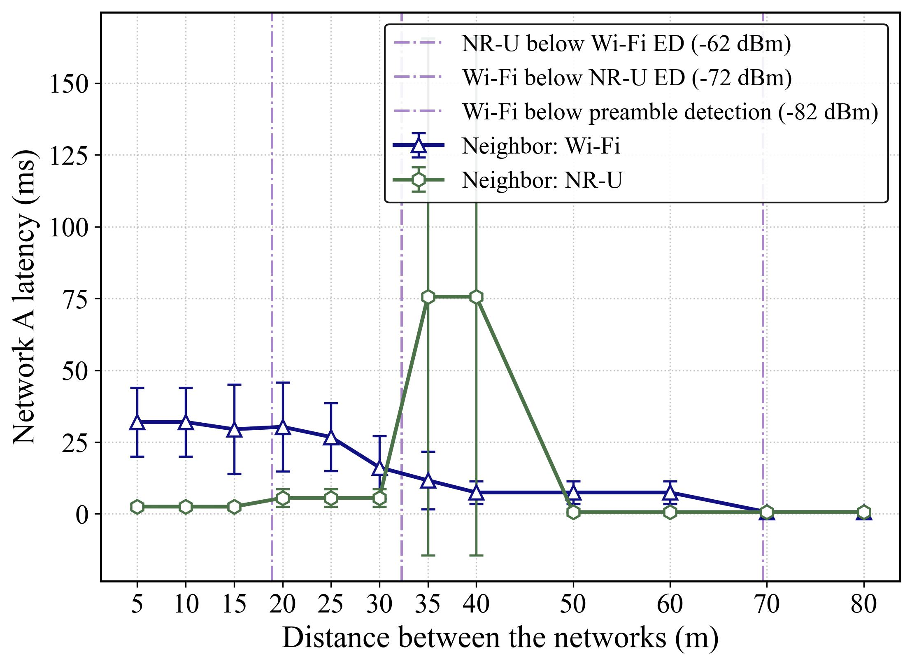

Network A's latency, and its frame failures in brackets:

| Distance | Neighbor Wi-Fi | Neighbor NR-U | Regime |
|---|---|---|---|
| 5–15 m | 30–32 ms (6–7%) | 2.5 ms (0.1%) | Both sides hear each other. NR-U **passes**: its 6 ms COTs are more efficient than a second Wi-Fi network, and the Wi-Fi pair is overloaded. |
| 20–30 m | 16–30 ms (2–5%) | 5.6 ms (25%) | One-sided: NR-U hears Wi-Fi, Wi-Fi doesn't hear NR-U. A quarter of Wi-Fi's frames are hit, but NR-U still waits for ongoing Wi-Fi frames, so latency passes. |
| **35–40 m** | **7.5–12 ms (0–1%)** | **75.6 ms (22%)** | **Neither side hears the other by energy detection**, but NR-U is still strong enough to break Wi-Fi frames. NR-U **fails** by 6–10×. |
| 50–60 m | 7.5 ms | 0.6 ms | NR-U is too weak to break Wi-Fi's MCS. The Wi-Fi pair still shares the channel through preamble detection. |
| 70–80 m | 0.6 ms | 0.6 ms | Independent. |

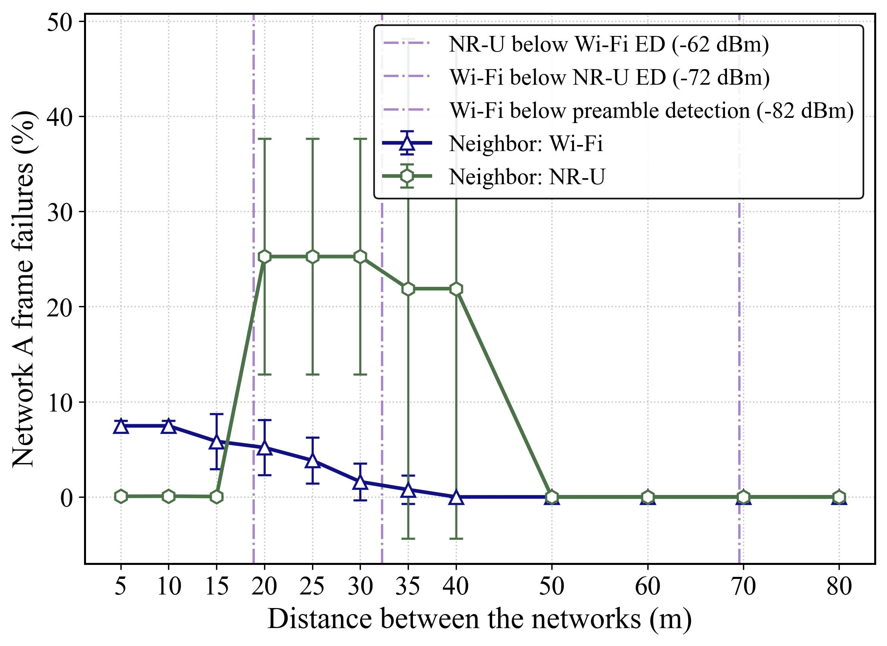

- **The worst case is not the one-sided energy-detection gap.** It is the band where neither side senses the other while NR-U still interferes. A Wi-Fi neighbor at the same distance is still heard, through its preamble.
- **Throughput hides the problem.** A saturated network A gets 21–23 Mbps next to NR-U, against 17–19 Mbps next to Wi-Fi, even at 35–40 m, because retries get packets through. Only latency and frame failures show the harm.

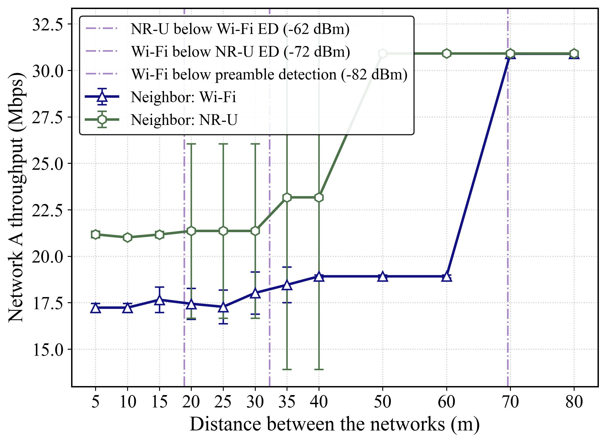

**Load.** At 40 m, NR-U fails the test from about 1000 pkt/s (5.8 vs 1.4
ms). At 4000 pkt/s, A's latency is 109 ms with 26% frame failures,
against about 6 ms next to Wi-Fi.

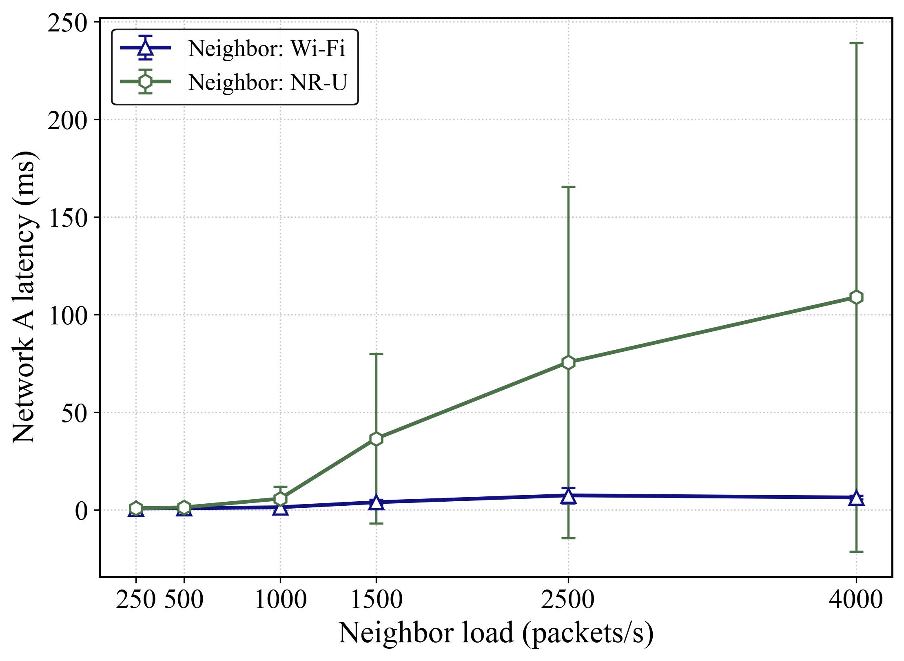

**Aggregation (pre_20.B).** Wi-Fi A-MPDU (`--wifi-ampdu 32`) cuts A's
latency at 40 m from 75.6 to 47.3 ms next to NR-U, against 7.5 → 3.2 ms
next to Wi-Fi. The gap is still about 15×. In the 19.F LAA scenario
aggregation makes things worse: Wi-Fi gets 0.64 Mbps, because a 5.4 ms
PPDU that can't hear NR-U almost always overlaps a COT.

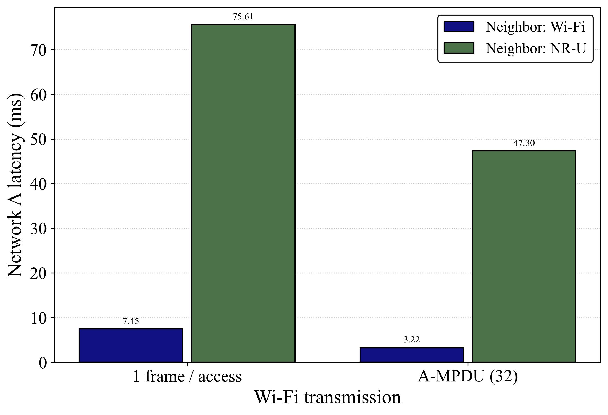

## 4. Mitigations (pre_20.D)

The replacement-test scoring is in
`python -m analysis.laa_fairness_mitigations [capc|ed|ed_distance|reservation]`.
The 19.F LAA scenario is scored by `python -m analysis.laa_scell_mitigations`.

### D.1 TS 37.213 channel access priority classes (`--nru-priority-class 1-4`)

| Class | m_p | CW_min | CW_max | MCOT (downlink) |
|---|---|---|---|---|
| 1 | 1 | 3 | 7 | 2 ms |
| 2 | 1 | 7 | 15 | 3 ms |
| 3 | 3 | 15 | 63 | 8 ms |
| 4 | 7 | 15 | 1023 | 8 ms |

The table above is TS 37.213 Table 4.1.1-1. UEs running their own
Type 1 LBT use Table 4.2.1-1.

**Result: no class fixes 40 m** (73–78 ms against 7.5 ms). The problem
is sensing, not contention parameters. At this load the COTs average
about 0.5 ms, so the MCOT never binds.

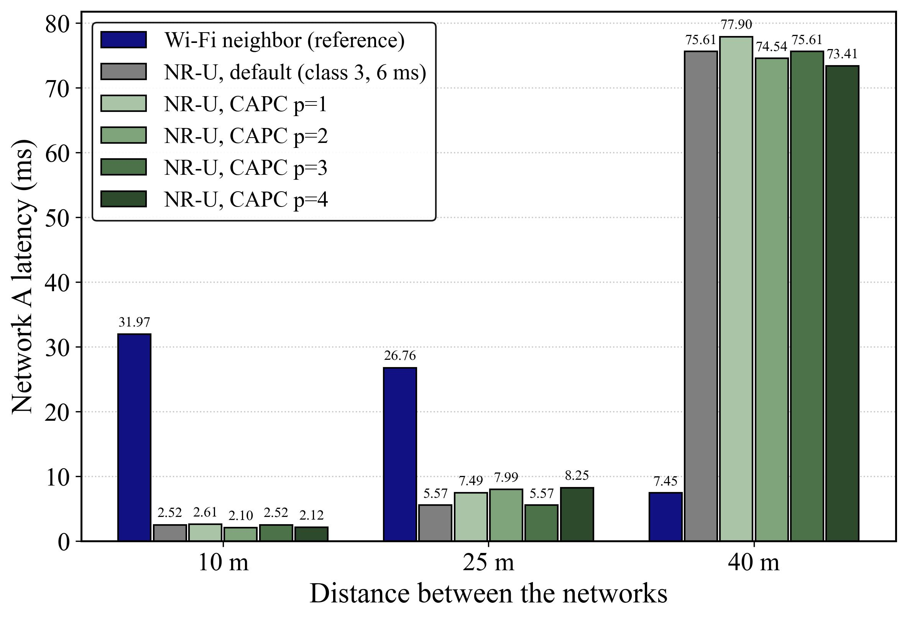

### D.2 Energy-detection threshold (`--nru-ed-mode ts37213`, `--nru-ed-threshold-dbm`)

TS 37.213 §4.1.5, for the case where another technology may share the
carrier:

X = max{−72 + 10·log10(BW/20), min{T_max, T_max − T_A + (P_H + 10·log10(BW/20) − P_TX)}}

At 20 MHz and 23 dBm this gives −72 dBm, the default. Lower transmit
power raises the threshold (18 dBm → −67, 13 dBm → −62). The max{}
means it never goes below −72.

**Results:**
- **The standard rule only moves the blind band.** At 18 dBm, NR-U fails at 25–30 m; at 13 dBm, at 10–20 m (up to 125 ms), and NR-U also loses throughput.
- **A non-standard −77 or −82 dBm threshold passes at every distance**, because NR-U now waits for Wi-Fi. But 13–25% of Wi-Fi's frames still fail: Wi-Fi still can't hear NR-U.

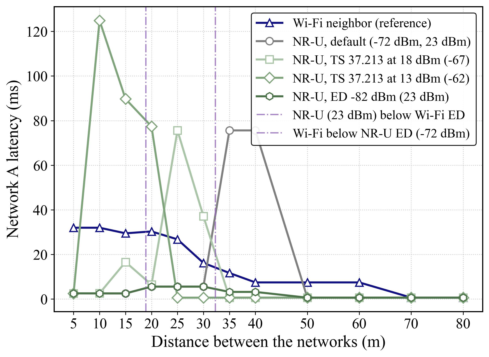

### D.3 Making COTs visible to Wi-Fi (`--nru-wifi-reservation preamble|cts_to_self`)

- **`preamble`:** NR-U transmissions carry an 802.11-decodable preamble, so Wi-Fi defers from −82 dBm. This has no airtime cost and is an upper bound.
- **`cts_to_self`:** before each COT, the gNB sends an 802.11 CTS-to-self (44 µs plus 16 µs SIFS, inside the MCOT). Its NAV covers the whole COT.

**Results:**
- **Either mode removes Wi-Fi's failures in the one-sided band (20–30 m).** They don't fix 35–40 m, where NR-U can't hear Wi-Fi either.
- **D.2 plus D.3 (ED −82 dBm + CTS-to-self) passes at every distance up to 60 m**, with about 0.03% Wi-Fi failures and about 3 ms latency.
- **At 70–80 m the 23 dBm CTS over-protects.** It can be decoded out to about 88 m, past a 20 dBm Wi-Fi neighbor's ~70 m, so Wi-Fi waits for COTs that couldn't hurt it (4.7 vs 0.6 ms).

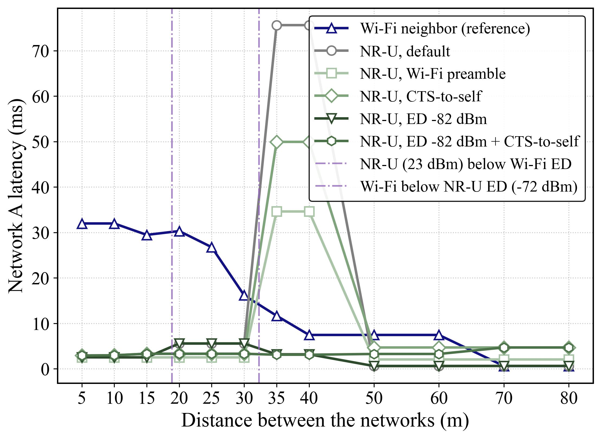

### D.4 Reference-slot feedback (`--nru-ref-nack-threshold`, `--nru-adaptive-cot`)

This makes the contention window grow on any loss (smaller NACK
threshold Z), and halves the COT length after a failed reference slot.

**Result: it is blind to the harm NR-U causes.** In the replacement test,
NR-U's reference slots fail 0% of the time at 25 and 40 m, while Wi-Fi
fails 31–36%. NR-U's UEs are close to the gNB, where Wi-Fi is weak.
Results are unchanged.

In the LAA scenario NR-U does see losses, and D.4 simply moves throughput
from NR-U to Wi-Fi:

| 19.F LAA scenario | Wi-Fi | NR-U SCell |
|---|---|---|
| Default | 5.2 Mbps | 37.8 Mbps |
| Z = 0.1 + adaptive COT (D.4) | 10.5 | 32.4 |
| ED −82 + CTS-to-self (D.2 + D.3) | 6.8 | **77.9** |
| ED −82 + CTS + class 1 | **13.0** | 56.2 |
| ED −82 + CTS + Wi-Fi A-MPDU 32 | 40.6 | 21.8 |

Wi-Fi alone gets 30.8 Mbps. Next to a saturated Wi-Fi neighbor it would get about half.

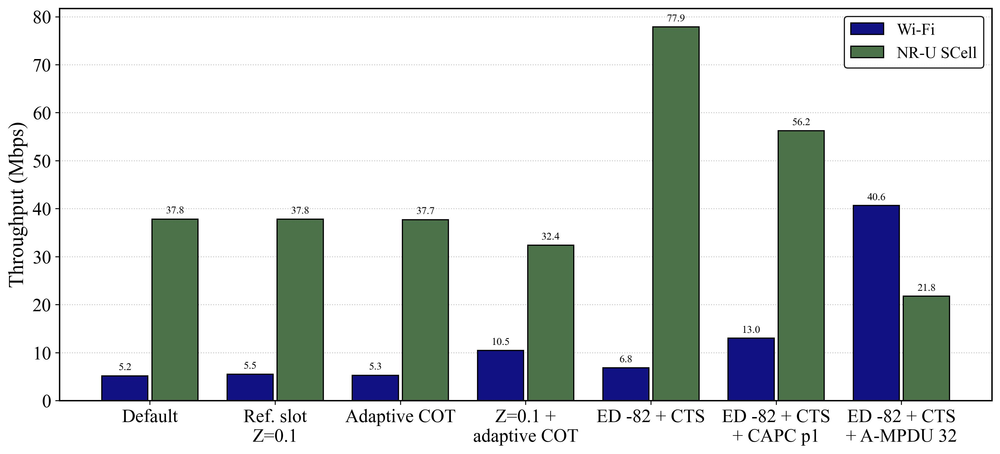

## 5. Conclusions

1. **The unfairness is a sensing problem.** It is not a contention-parameter or feedback problem. Energy detection at −62 dBm (Wi-Fi) and −72 dBm (NR-U) leaves a band, about 32–45 m here, where each side transmits over the other.
2. **Both sides need fixing.** NR-U needs a lower threshold to hear Wi-Fi (non-standard: TS 37.213 floors at −72 dBm). Wi-Fi needs something it can decode (CTS-to-self or a preamble). Together they pass the replacement test everywhere the networks interact. Each alone leaves 9–25% Wi-Fi frame failures somewhere.
3. **Standard knobs don't get there.** Priority classes, the 37.213 power/threshold trade-off, and reference-slot feedback either do nothing or just move throughput from one side to the other.
4. **After the sensing fix, what's left is airtime per channel access.** A ~0.25 ms Wi-Fi frame competes with a 6 ms COT. Class 1 (2 ms MCOT) gives the most even split in the LAA scenario. With Wi-Fi A-MPDU the balance flips to Wi-Fi: NR-U then loses in its sync-slot gap, because after its backoff it waits for the next slot boundary and Wi-Fi takes the channel in between. That gap is an NR-U disadvantage of its own, and worth a follow-up (reservation signal vs gap).

## 6. Simulator bug found along the way (pre_20.D.3a)

Under the full-power SINR rule for Wi-Fi frames (pre_18.A), interferers
were summed per transmission. So a Wi-Fi frame overlapping two
consecutive transmissions from the same node counted that node twice
(+3 dB); the two transmissions could be a CTS and its COT, or two
back-to-back NR-U COTs.

It is now counted at the node's peak instantaneous power. This changed
one of the 14 regression cases (2 gNBs: Wi-Fi collision probability
0.421 → 0.381). Every study result above was re-run with the fix and is
unchanged.

## 7. Re-validation on the Step 20-21 Wi-Fi stack (Step pre_22)

The study above ran with the original Wi-Fi model: the ACK time was only
waited out, the PHY was legacy 802.11a and every access carried one frame.
Steps 20-21 added the real frame exchange (ACK / NAV / EIFS on the air),
HE rates and A-MPDU, and fixed EDCA. None of the earlier scripts use the
new options, so every figure above is unchanged (checked: the baseline CSV
and the CCNC occupancy figures regenerate byte-identical). The question
is whether the conclusions hold when the realistic options are on.

`python -m analysis.laa_revalidation` repeats the replacement test with
three Wi-Fi stacks: original, frame exchange on the air
(`--wifi-mac-exchange`), and HE20 MCS 7 + A-MPDU 32 + frame exchange.

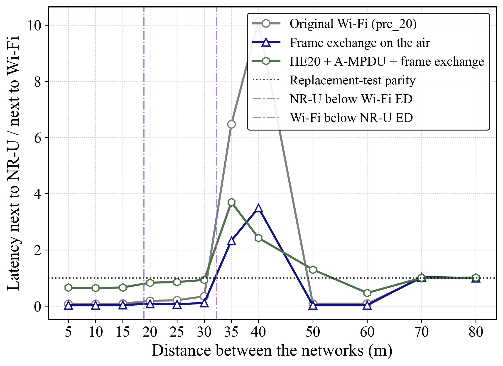

| Distance | Original | Frame exchange | HE20 + A-MPDU |
|---|---|---|---|
| 5-30 m | passes (ratio 0.08-0.34) | passes (0.03-0.11) | passes (0.64-0.93) |
| 35-40 m | **fails** (6.5-10.2) | **fails** (2.3-3.5) | **fails** (2.4-3.7) |
| 50 m | passes | passes | **fails** (1.30) |
| 60-80 m | passes | passes | passes |

The ratio is network A's latency next to NR-U over its latency next to a
Wi-Fi neighbor.

- **The diagnosis holds on every stack.** NR-U fails exactly where
  neither side hears the other by energy detection while NR-U still
  breaks Wi-Fi frames.
- **The failing band widens with an efficient Wi-Fi.** A Wi-Fi neighbor
  with HE and aggregation keeps network A's latency near 1 ms, so the
  ~10% frame failures NR-U still causes at 50 m are now visible.
- **The ratios look milder with the frame exchange.** That's because the
  Wi-Fi reference gets worse: with collisions counted correctly, two
  Wi-Fi networks next to each other collide more (A's latency at 10 m:
  32 -> 66 ms).

Mitigations at 10 / 25 / 40 m (`... laa_revalidation mitigations`): ED
-82 dBm + CTS-to-self passes everywhere on both new stacks, with ~0 Wi-Fi
frame failures. ED -82 alone passes but leaves 12-15% failures.
CTS-to-self alone still fails at 40 m with the frame exchange, and only
just passes with HE + A-MPDU.

### Follow-ups

- **A power-matched CTS removes the over-protection.** The 23 dBm
  CTS-to-self is decodable to ~88 m, past a 20 dBm Wi-Fi neighbor's
  ~70 m, so at 70-80 m Wi-Fi waited for COTs that couldn't hurt it
  (4.69 vs 0.63 ms, a fail). With `--nru-cts-power-dbm 20`, 70-80 m
  match the Wi-Fi reference (0.63 ms) and 50-60 m still pass. ED -82 dBm
  + a 20 dBm CTS-to-self now passes the replacement test at every
  distance.
- **A reservation signal closes NR-U's sync-slot gap.** After its
  backoff, NR-U used to wait silently for the next 1 ms slot boundary,
  and a Wi-Fi network with long A-MPDUs took the channel in that gap.
  With `--nru-reservation-signal` NR-U transmits until the boundary
  instead. In the 19.F LAA scenario (with ED -82 + CTS-to-self and Wi-Fi
  A-MPDU 32) the split moves from Wi-Fi 41 / SCell 22 Mbps to Wi-Fi 20 /
  SCell 56 Mbps (NR-U COTs 30-43 -> ~100 per second). That is about the
  even share a Wi-Fi neighbor would leave; Wi-Fi alone gets 30.8. The
  reservation signal carries no data and comes out of the COT.

### The CCNC occupancy validation

`python -m analysis.occupancy_revalidation` repeats the DTMC comparison
(1-6 co-located APs + one gNB, fixed contention window, 5.4 ms frames)
with the frame exchange on.

- **The model's Wi-Fi occupancy is counted the simulator's way.** The
  DTMC's Cw charges each success Twp + SIFS + ACK + DIFS + σ; the
  simulator counts the data plus SIFS + ACK. `compare_dtmc` now reports
  the model's success rate at the simulator's accounting (`model_Cw`; the
  paper's value stays in `model_Cw_dtmc`). That is about 0.9 points
  lower, and the figures use it.
- **The original stack then matches up to 4 APs.** The Wi-Fi deviation is
  0.1-0.5 points for 1-4 APs and 1.8 / 2.4 points at 5 / 6 APs, where the
  simulator's fixed-window Wi-Fi collides more than the paper's eq. 7
  attempt rate predicts. Mean deviation: Wi-Fi 0.83 points, NR-U 0.80.
- **Agreement gets worse with the frame exchange.** Mean deviation from
  the model: Wi-Fi 0.83 -> 3.07 points, NR-U 0.80 -> 1.81, growing with
  the number of APs (6 APs: Wi-Fi 0.804 -> 0.771, model 0.828).
- **The DTMC (from the CAD paper) models neither effect behind it.** One
  is EIFS after collisions: switching EIFS off brings NR-U back to the
  original value. The other is the higher collision rate the frame
  exchange produces (Wi-Fi collision probability 0.234 -> 0.260 at 6 APs
  - the same correction that made the simulator match Bianchi in 20.A).
- **So the CCNC validation stands for the simplified MAC it was built
  against.** With the full 802.11 exchange the model over-predicts Wi-Fi
  occupancy by 2-6 points from 3 APs up.

## 8. On a realistic channel (Step 22)

Everything above used log-distance path loss (exponent 3) with no
shadowing or fading, so the regimes are sharp steps. Step 22 added the
3GPP TR 38.901 and TGax path-loss models, spatially correlated shadowing,
flat fading and multi-cell layouts. `python -m analysis.realism_study`
repeats the test on them.

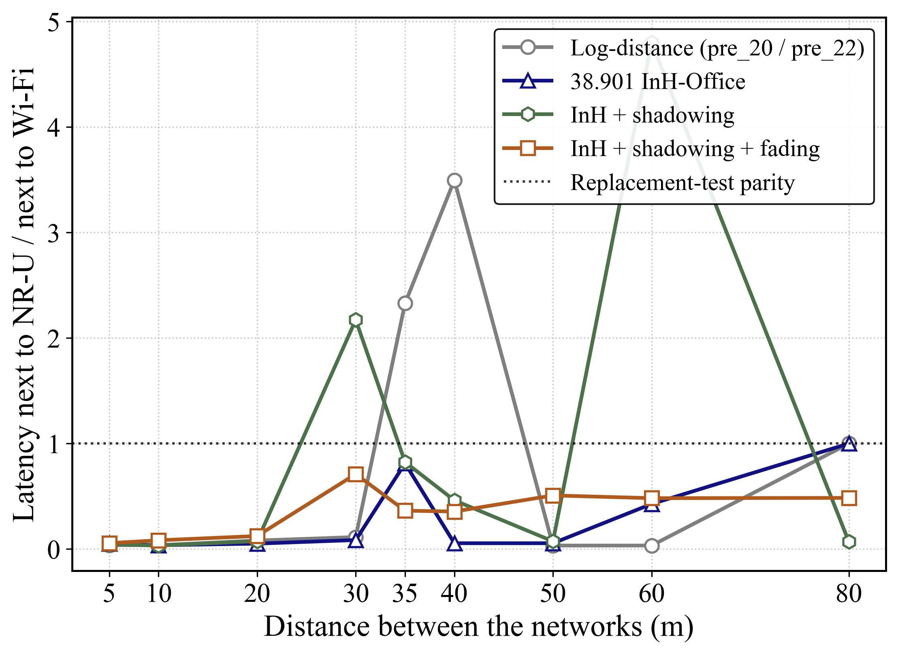

**Two networks against distance** (the setup above, frame exchange on, 5
seeds x 1 s). The ratio is network A's latency next to NR-U over its
latency next to a Wi-Fi neighbor.

| Channel | Fails at | Highest ratio |
|---|---|---|
| Log-distance (as before) | 35, 40 m | 3.50 |
| 38.901 InH-Office (mixed) | nowhere | 0.81 (35 m) |
| InH + shadowing | 30, 60 m | 4.80 (60 m) |
| InH + shadowing + fading | nowhere | 0.71 (30 m) |

- **The failing band is a property of the propagation model, not a fixed
  distance.** InH loses about 9 dB less than log-distance at short range,
  so Wi-Fi hears NR-U's energy over the distances where it used to miss
  it, and the band disappears.
- **Shadowing moves the failures around.** Each seed is a different
  shadowing draw, so a link lands in the "NR-U hears Wi-Fi, Wi-Fi doesn't
  hear NR-U" window at some distances and not others. Five seeds per
  distance aren't enough to say where; the mechanism is the same.
- **Fading makes the reference worse, not NR-U better.** Fades break
  frames in both cases, so a Wi-Fi neighbor already costs network A tens
  of milliseconds, and NR-U's effect is relatively smaller.

**The test on its own layout** (TR 38.889 indoor: 120 m x 80 m, two
operators x 3 cells, 5 users per cell re-dropped below -82 dBm serving
power, InH + shadowing + fading, preamble detection, rate adaptation, 23
dBm, Poisson load per cell, 5 seeds x 2 s). Operator B is Wi-Fi; operator
A is Wi-Fi or NR-U.

| Load per cell | Operator A | B latency (ms) | B throughput (Mbps) | Test |
|---|---|---|---|---|
| 50 pkt/s (0.6 Mbps) | Wi-Fi | 4.31 +- 2.61 | 1.72 | reference |
| | NR-U | 1.96 +- 0.60 | 1.73 | passes |
| | NR-U, ED -82 dBm + 20 dBm CTS-to-self | 1.73 +- 0.35 | 1.83 | passes |
| 100 pkt/s (1.2 Mbps) | Wi-Fi | 181 +- 59 | 2.27 | reference |
| | NR-U | 49.5 +- 50.4 | 3.17 | passes |
| | NR-U, ED -82 dBm + 20 dBm CTS-to-self | 25.5 +- 33.3 | 3.33 | passes |

- **NR-U passes on the 3GPP layout.** All six cells share one 20 MHz
  channel, and at 100 pkt/s the middle Wi-Fi cell already saturates when
  its neighbor is Wi-Fi. An NR-U neighbor costs operator B less than a
  Wi-Fi one. Why hasn't been isolated; fewer, longer channel accesses are
  a likely reason. ED -82 dBm + CTS-to-self (Wi-Fi then sees NR-U's
  COTs) helps further.
- **Without the -82 dBm re-drop rule the layout isn't meaningful.** With
  InH shadowing, users 40-60 m from their cell can be out of coverage,
  and a Wi-Fi-only room's failure ratio went from 0.15 to 0.64.
  `--layout-min-serving-dbm -82` applies the rule.

So the pre_20 diagnosis (the unfairness comes from asymmetric sensing)
still holds, but where it bites depends on the propagation, and on the
3GPP indoor layout NR-U meets the replacement test.

## 9. With the Step 23 fidelity fixes

Step 23 removed the remaining simplifications that favoured one side:

- **Collision window** (`--cca-detect-us 6`). Sensing used to be
  instantaneous, so whichever node started first always won and Wi-Fi
  and NR-U almost never collided. Now a transmission is invisible to
  sensing for its first 6 us (CCA time + RX/TX turnaround). In the DTMC
  scenario this brings Wi-Fi/NR-U collisions to ~2.9 per second, against
  the model's 2.3.
- **Real NR-U payload** (pre_23.B, default). A burst-model COT used to
  carry one 1500 B packet; it now carries what its MCS and duration hold.
- **FTP Model 3 traffic** (`--wifi-traffic-model ftp3`,
  `--nru-traffic-model ftp3`), the traffic TR 36.889 defines the test
  with: 0.5 MB files arriving per user. The metric is the user-perceived
  throughput (UPT): file size over transfer time.
- **Confidence intervals.** Studies run 20 seeds in parallel and report
  mean +- 95 % CI.

`python -m analysis.coexistence_study` runs the checks below (~50 min on
8 processes).

**The DTMC comparison is unchanged.** Under the defaults, Wi-Fi and NR-U
occupancy for 1-6 APs equal the pre_22.C numbers exactly. Every Step 23
option is off by default, and pre_23.B doesn't touch saturated channel
access.

**The replacement test on its own layout** (TR 38.889 indoor; FTP Model 3
on every cell; InH-Office + shadowing + fading; collision window;
preamble detection; rate adaptation; 23 dBm; NR-U slots model; 20 seeds
x 10 s). Operator B is Wi-Fi. The table gives B's UPT averaged over its
files, mean +- 95 % CI over the seeds.

| Files/s per cell | Operator A | B UPT (Mbps) | B 5th pct UPT | B transfer (ms) | Test |
|---|---|---|---|---|---|
| 0.25 (1 Mbps) | Wi-Fi | 25.0 +- 2.0 | 11.5 | 184 +- 24 | reference |
| | NR-U | 28.1 +- 1.3 | 14.5 | 151 +- 11 | passes |
| | NR-U, ED -82 + CTS 20 dBm | 27.2 +- 1.5 | 14.5 | 167 +- 24 | passes |
| 0.5 (2 Mbps) | Wi-Fi | 18.2 +- 2.9 | 3.1 | 471 +- 265 | reference |
| | NR-U | 25.7 +- 1.3 | 9.6 | 189 +- 23 | passes |
| | NR-U, ED -82 + CTS 20 dBm | 24.2 +- 1.7 | 6.2 | 210 +- 35 | passes |
| 1.0 (4 Mbps) | Wi-Fi | 11.3 +- 3.1 | 1.1 | 1155 +- 341 | reference |
| | NR-U | 15.0 +- 3.4 | 1.3 | 958 +- 420 | passes |
| | NR-U, ED -82 + CTS 20 dBm | 16.2 +- 3.1 | 1.6 | 781 +- 347 | passes |

- **NR-U passes at every load.** Operator B does better next to NR-U
  than next to another Wi-Fi operator, and the gap grows with load (UPT
  +12 % at the low load, +41 % at the medium one).
- **The mitigation is a wash at low load and helps at high load.** ED
  -82 dBm + a 20 dBm CTS-to-self is within the CIs of plain NR-U at 0.25
  and 0.5 files/s, and gives B the shortest transfers at 1.0 files/s.

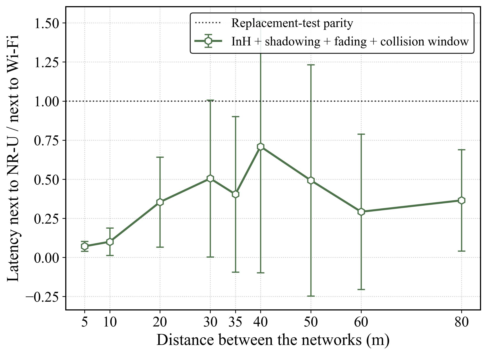

**Two networks against distance** (the section 3 setup on the full
realistic channel, 20 seeds per point). The latency ratio (A next to NR-U
over A next to Wi-Fi) is 0.07-0.71: **it passes at every distance.** The
CIs are wide (shadowing and fading make A's latency vary a lot between
seeds). The ratio's CI is a symmetric approximation, which is why some
bars dip below zero. With 20 seeds the scattered failures section 8 saw
with 5 seeds don't appear.

**Caveats.**

- **Not every file completes.** Only 43-72 % of B's files finish. A file
  needs all 334 of its packets, and Wi-Fi drops a packet after its MAC
  retry limit, with no TCP-like retransmission above it. UPT is over
  completed files.
- **The mechanism hasn't been isolated.** Why an NR-U neighbor costs B
  less than a Wi-Fi one isn't established. Fewer, longer channel accesses
  and NR-U's own LBT are the likely reasons.

So, with collisions, payloads, traffic and statistics now modelled the
way the 3GPP evaluation does, NR-U meets the replacement test on the
TR 38.889 layout at low, medium and high load.

## 10. Limitations

- **Shadowing, fading and the collision window are opt-in (Steps 22-23).** Sections 3-7 are without them; section 8 adds the channel on 5 seeds, section 9 the Step 23 fixes on 20 seeds.
- **One topology** in sections 3-7: one AP, one neighbor, STAs and UEs within 5 m, 20 MHz on a single channel, 802.11a rates.
- **The NAV is optimistic.** Every Wi-Fi node in decoding range honors it, including one that was transmitting when the CTS went out. The preamble mode is an upper bound in the same way.
- **The replacement test uses unsaturated loads** (except the throughput sweep). The pass criterion is latency-based.
- **A-MPDU** is 802.11n-style aggregation on the legacy 20 MHz rate table, for the AP downlink only.

## 11. Reproduce

```bash
python -m analysis.laa_fairness              # baseline replacement test (pre_20.A)
python -m analysis.laa_fairness_sweeps       # distance / load / A-MPDU sweeps (~8 min)
python -m analysis.laa_fairness_mitigations  # D.1-D.3 scoring (~20 min; or name one study: capc, ed, ed_distance, reservation)
python -m analysis.laa_scell_mitigations     # 19.F LAA scenario (~3 min; --plot-only redraws)
python -m analysis.laa_revalidation          # pre_22: the test on three Wi-Fi stacks (~12 min)
python -m analysis.occupancy_revalidation    # pre_22: DTMC validation with the frame exchange (~5 min)
python -m analysis.realism_study             # Step 22: the test on realistic channels and the TR 38.889 layout (~20 min)
python -m analysis.coexistence_study        # Step 23: FTP Model 3 test, distance with CIs, DTMC check (~50 min, parallel)
```

CSVs land in `analysis/generated/` (untracked). Figures are written there
as PDF and JPG.
